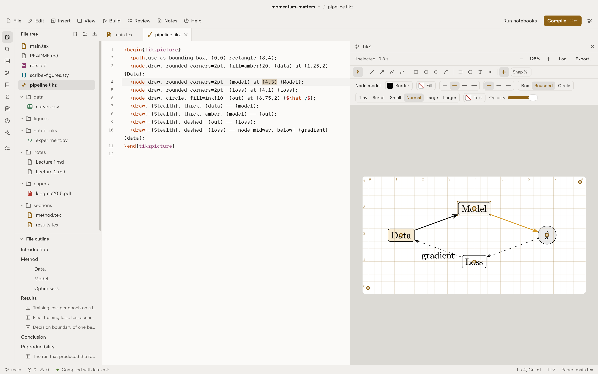
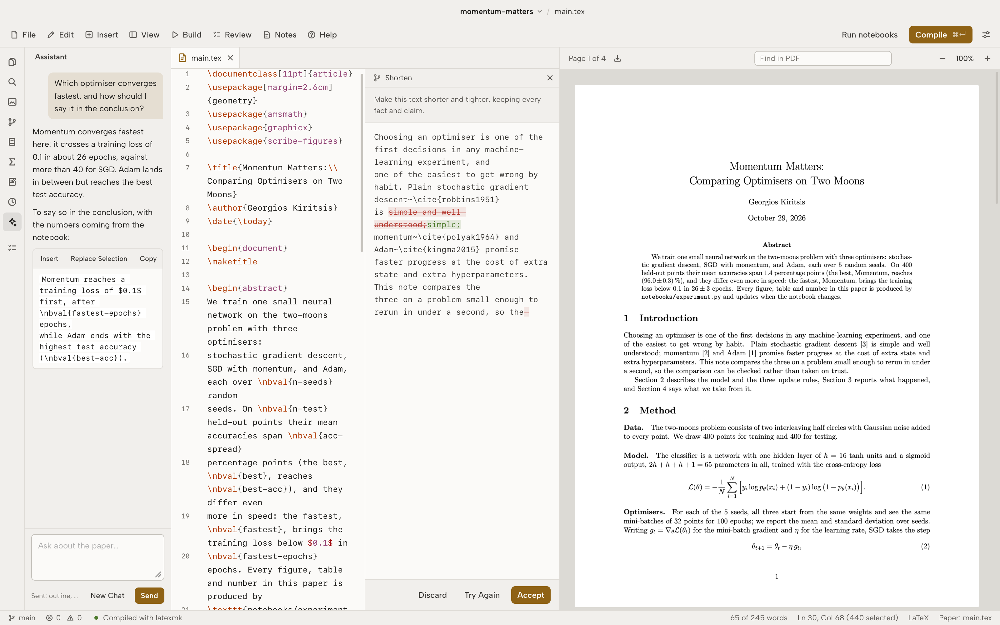
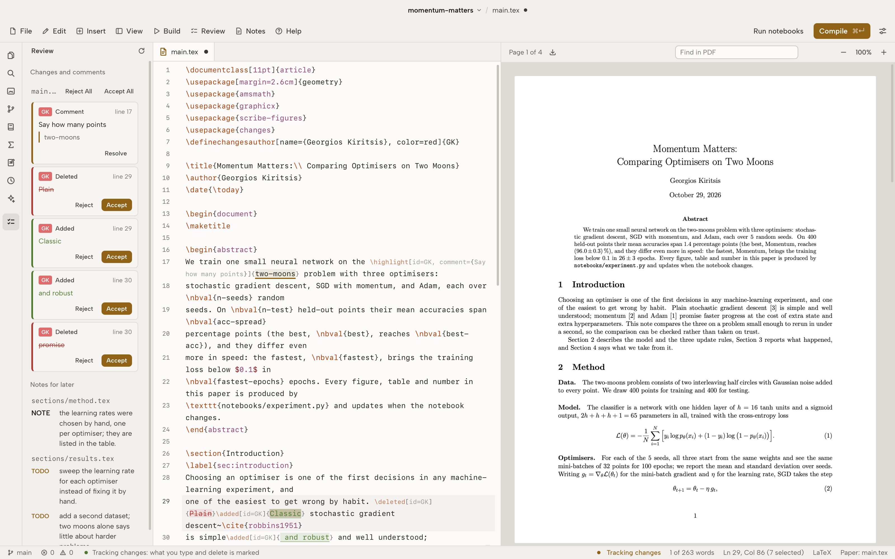

<p align="center">
  <picture>
    <source media="(prefers-color-scheme: dark)" srcset="docs/logo-dark.svg">
    
  </picture>
</p>

<p align="center">
  <a href="https://github.com/Scribe-IDE/Scribe/actions/workflows/check.yml"></a>
  <a href="https://github.com/Scribe-IDE/Scribe/releases/latest"></a>
  <a href="LICENSE"></a>
  
  
  
  
</p>

<p align="center">
  <a href="https://scribe.georgekiritsis.com"><b>Website</b></a>
  &nbsp;&middot;&nbsp;
  <a href="#features"><b>Features</b></a>
  &nbsp;&middot;&nbsp;
  <a href="#notebooks-in-the-paper"><b>Notebooks</b></a>
  &nbsp;&middot;&nbsp;
  <a href="#keyboard-shortcuts"><b>Shortcuts</b></a>
  &nbsp;&middot;&nbsp;
  <a href="#download"><b>Download</b></a>
  &nbsp;&middot;&nbsp;
  <a href="#building-from-source"><b>Build</b></a>
  &nbsp;&middot;&nbsp;
  <a href="#development"><b>Development</b></a>
  &nbsp;&middot;&nbsp;
  <a href="#license"><b>License</b></a>
</p>

<br>

Scribe is a desktop editor for LaTeX papers. A paper, the Python notebooks behind it and the
figures they make live in one project folder, and the figures and numbers in the PDF come
straight from the notebooks. Everything compiles on your machine with Tectonic or TeX Live.
There is no account and nothing is uploaded.

<picture>
  <source media="(prefers-color-scheme: dark)" srcset="docs/screenshot-dark.png">
  
</picture>

## Features

- [Writing LaTeX](#writing-latex)
- [Notebooks in the paper](#notebooks-in-the-paper)
- [TikZ, drawn and written](#tikz-drawn-and-written)
- [An assistant, with your own model](#an-assistant-with-your-own-model)
- [Track changes and comments](#track-changes-and-comments)
- [Revisions and the response to reviewers](#revisions-and-the-response-to-reviewers)
- [Before submitting](#before-submitting)
- [References](#references)
- [Notes, reading and revision cards](#notes-reading-and-revision-cards)
- [Looks](#looks)
- [Projects](#projects)

### Writing LaTeX

The editor is CodeMirror 6 and knows LaTeX.

- **Completion** for commands, environments, packages, `\ref` labels, `\cite` keys, figures and
  notebook values, from every file of the paper.
- **Snippets**: type `fig`, `tab`, `eq`, `ali`, `sec`, `thm` and others, then Tab, and fill in
  the fields. Add your own in Settings, or import a VS Code `latex.json`.
- **Hover** over `\ref` to see the equation typeset, the figure drawn or the section's title;
  over `\cite` for the paper's title, authors and year; over `\nbval` for the value.
- **Writing checks** underline eleven common slips, each with a one-click fix: a breakable space
  before `\ref`, a repeated word, straight quotes, `$$ … $$`, `\bf` and friends, `...`, a space
  before `\footnote`, `\label` before `\caption`, unbalanced `\left`/`\right`, the space after
  "e.g." and after a sentence ending in capitals. Each can be turned off.
- **Maths**: a preview of the formula under the cursor, a symbol palette, and an equation editor
  (<kbd>⌥⌘E</kbd>) where maths is typed as it looks, with a keyboard of symbols; it writes back
  LaTeX and keeps the environment and `\label`.
- **Tables** edited as a grid: alignment, rules, rows and columns, paste from a spreadsheet.
- **Compiling** on demand, on save, or as you type, with Tectonic or `latexmk`. Errors are
  explained in plain words and underlined in the source. Click in the PDF to find the line, and
  the other way round (SyncTeX). Spell check uses the system dictionary on macOS. Vim keys are
  there if you want them.

### Notebooks in the paper

Python files with `# %%` cells and Jupyter `.ipynb` notebooks open as cells and run in a Python
kernel that Scribe keeps running. A figure cell saves `figures/<id>.pdf`; `nbval` and `nbtable`
send numbers and tables to the paper, typeset with siunitx. When a notebook changes, its figures
are marked out of date and rerun on the next compile. Each run records the Python version,
packages, seed and git commit, which the paper can print with `\nbenv`.

A cell marked as a figure in `notebooks/experiment.py`:

```python
# %% [figure: fig-loss]
fig, ax = plt.subplots()
ax.semilogy(epochs, loss)
nbval("best-acc", 96.4, unit="%", err=0.3)
```

and the paper that uses it:

```latex
\usepackage{scribe-figures}
...
The best run reaches \nbval{best-acc} (Figure~\ref{fig:loss}).
\begin{figure}
  \centering
  \nbfig{fig-loss}
  \caption{Training loss.}\label{fig:loss}
\end{figure}
```

Compiling runs the notebook if it changed, writes `figures/fig-loss.pdf` and the values, and
typesets the paper. The example project in [`example/`](example) is a complete paper built this
way. CSV and TSV files open as a table, with a quick plot and "Insert as LaTeX table".

### TikZ, drawn and written

<picture>
  <source media="(prefers-color-scheme: dark)" srcset="docs/tikz-dark.png">
  
</picture>

Put the cursor in a `tikzpicture` and press <kbd>⌥⌘K</kbd>: the picture is compiled on its own,
with the paper's preamble, and drawn beside the source in about half a second, again after every
edit.

- **Drag** any point or node; the coordinates change in the source.
- **Draw** lines, arrows, polylines, curves, rectangles, circles, ellipses, arcs, nodes, text and
  points on a grid, with snapping. A line drawn between two nodes is written as `(a) -- (b)`.
- **Style** the selection from a bar: colours, fill, line width and dash, arrow tips, node shape,
  font size, opacity. Select several, move, duplicate, delete, undo.
- **Export** as PDF, SVG or PNG, or replace the picture with the image and keep its TikZ in a
  `.tikz` file. Pictures also show as thumbnails in the Figures panel.

The source stays the one truth: every change is a plain edit to the TikZ, which you can undo.
[`demo/tikz/`](demo/tikz) has pictures to try.

### An assistant, with your own model

<picture>
  <source media="(prefers-color-scheme: dark)" srcset="docs/ai-dark.png">
  
</picture>

Claude, GPT, Gemini, any OpenAI-compatible service (OpenRouter, Groq, LM Studio), or a model
running on your computer with Ollama: you choose, with your own key, which stays in the system
keychain. Nothing is sent until you set a provider.

- **Ask about the paper** in a side panel (<kbd>⌥⌘A</kbd>). It knows the outline, the open
  section and the bibliography keys; LaTeX it suggests goes in with one click.
- **Edit with AI** (<kbd>⌥⌘I</kbd>) on a selection: improve, shorten, fix grammar, make it more
  formal or simpler, translate to English, tidy the LaTeX, or say what to do. The change is shown
  word by word before you accept it.
- **Fix a compile error** from the Problems list.
- **Suggestions as you type**, in grey; Tab takes them. Off unless you turn it on.

Only what a request needs is sent, and the panel says what that is.

### Track changes and comments

<picture>
  <source media="(prefers-color-scheme: dark)" srcset="docs/track-dark.png">
  
</picture>

With Track Changes on (<kbd>⇧⌘E</kbd>), what you type is marked as `\added`, what you delete as
`\deleted`, with your initials, using the standard `changes` package. The marks live in the
source, so they show in colour in the PDF, travel with git, and work for co-authors in any
editor, Overleaf included.

- **Comments** (<kbd>⌥⌘M</kbd>) on a selection or at the cursor, shown in the PDF's margin.
- **Review panel**: every change and comment across the paper, with Accept, Reject and Resolve,
  or all of a file at once. <kbd>⌥⌘.</kbd> goes to the next one.
- **Show Changes in PDF** switches between the marked-up paper and the paper as if every change
  were accepted.

### Revisions and the response to reviewers

- **Compare with an earlier version**: pick a git commit or a version Scribe saved, and latexdiff
  marks what changed, in the PDF.
- **Response to Reviewers** starts a letter from a template, one reply per point; text selected
  in the marked-up PDF is quoted into it with its page.
- **History**: earlier versions of every file are kept on save, to compare with now or restore.

### Before submitting

One command lists missing citations and labels, figures the text never refers to, notebooks that
are out of date, leftover TODOs, and what arXiv would object to (file names, size). Each is a
click away from its place in the source. Export makes a zip a publisher can compile: one `.tex`
with everything inlined, the figures and the bibliography. `% TODO` and `\todo{}` notes are
gathered in the Review panel.

### References

Add a BibTeX entry from a DOI or an arXiv ID (<kbd>⇧⌘C</kbd>), or pick it from a running Zotero 7,
including while typing in `\cite{}`. The References panel lists the bibliography.

### Notes, reading and revision cards

- **Markdown notes** with maths, headings, checkboxes, images and code rendered in place,
  `[[links]]` between notes, `@key` citations and tags. Today's note and a quick note are a
  shortcut away; a note copies as LaTeX or exports to PDF.
- **A reader** for PDFs in `papers/`: select text, highlight it, and the quote lands in the
  paper's note with a link to its page.
- **Revision cards** from `Q:` and `A:` lines, reviewed with spaced repetition, exported for
  Anki.
- **Sketches**: a drawing canvas for notes (<kbd>⌥⌘D</kbd>).

### Looks

- **Eleven themes**: Scribe Dark and Light, Gruvbox, Solarized Dark and Light, Nord, Catppuccin
  Mocha and Latte, GitHub Dark and Light, Tokyo Night. Or follow the system's light and dark.
- **Your own theme** from a theme editor, every colour live, shared as a JSON file. Any accent
  colour on any theme.
- **Fonts**: JetBrains Mono, Fira Code, IBM Plex Mono, Iosevka, Source Code Pro, or any font
  installed on your system; ligatures, line height and interface size.
- **Dark PDF**: the paper shown light on dark, with its figures and images kept in their colours.
- **Focus mode** (<kbd>⌥⌘F</kbd>): only the text, centred, the line you write kept mid-screen,
  and today's word count against a goal.

### Projects

- **Templates**: a plain article, IEEE and ACM conference papers, a thesis, slides, lecture notes,
  an article with a notebook.
- **Import** an Overleaf project from its zip, or clone a git repository.
- **Git panel**: changes, diffs, commit, push, history.
- **A terminal** in the project folder, a file tree with drag and drop, search across the
  project, an outline that follows `\input`, and a side pane for a second file.
- Open tabs, cursors and panels come back when the project opens again.

## Keyboard shortcuts

On Windows and Linux, <kbd>Ctrl</kbd> takes the place of <kbd>⌘</kbd> and <kbd>Alt</kbd> of
<kbd>⌥</kbd>. Every command is also in the command palette (<kbd>⇧⌘P</kbd>).

| Command | Keys |
|---|---|
| Compile | <kbd>⌘↵</kbd> |
| Run notebooks / the cell | <kbd>⇧⌘↵</kbd> / <kbd>⇧↵</kbd> |
| Show the cursor's place in the PDF | <kbd>⇧⌘J</kbd> |
| Go to file / command palette | <kbd>⌘P</kbd> / <kbd>⇧⌘P</kbd> |
| Find in project / in the PDF | <kbd>⇧⌘F</kbd> / <kbd>⇧⌘G</kbd> |
| Preview TikZ | <kbd>⌥⌘K</kbd> |
| Equation editor | <kbd>⌥⌘E</kbd> |
| Citation from DOI or arXiv | <kbd>⇧⌘C</kbd> |
| Assistant / Edit with AI | <kbd>⌥⌘A</kbd> / <kbd>⌥⌘I</kbd> |
| Track changes / add a comment / next change | <kbd>⇧⌘E</kbd> / <kbd>⌥⌘M</kbd> / <kbd>⌥⌘.</kbd> |
| Focus mode | <kbd>⌥⌘F</kbd> |
| Today's note / quick note / sketch | <kbd>⌥⌘T</kbd> / <kbd>⌥⌘N</kbd> / <kbd>⌥⌘D</kbd> |
| Sidebar / log | <kbd>⌘B</kbd> / <kbd>⌘J</kbd> |

## Download

Installers for macOS, Windows and Linux are attached to each
[release](https://github.com/Scribe-IDE/Scribe/releases/latest). Scribe updates itself from
there: when a new version is out, it offers to install it.

The macOS app isn't notarized by Apple yet, so the first time, open it with right-click > Open.

## Building from source

Scribe is a [Tauri 2](https://tauri.app) app: a TypeScript front end and a Rust back end. On
every system you need:

- [Node.js](https://nodejs.org) 20 or later
- [Rust](https://rustup.rs) (stable)
- a TeX engine: [Tectonic](https://tectonic-typesetting.github.io), which the app can install for
  you on first run, or a TeX distribution with `latexmk`
- Python 3 with matplotlib, for notebooks (optional)

Then, in a clone of this repository:

```sh
npm install
npm run tauri dev      # run it, with hot reload
npm run tauri build    # an installable build, in src-tauri/target/release/bundle/
```

### macOS

```sh
xcode-select --install          # Apple's compilers
brew install node rustup tectonic
rustup default stable
```

`npm run tauri build -- --bundles app` makes `Scribe.app` alone, without a disk image. macOS is
where Scribe is used every day.

### Windows

1. Install the [Microsoft C++ Build Tools](https://visualstudio.microsoft.com/visual-cpp-build-tools/)
   with the "Desktop development with C++" workload.
2. WebView2 ships with Windows 10 and 11; on older systems install the
   [Evergreen runtime](https://developer.microsoft.com/microsoft-edge/webview2/).
3. Install Rust with `rustup` (the default MSVC toolchain) and Node.js.
4. For TeX, let Scribe install Tectonic, or install [MiKTeX](https://miktex.org) or TeX Live;
   `latexmk` on MiKTeX also needs Perl.

`npm run tauri build` produces an `.msi` and an `.exe` installer.

### Linux

Debian and Ubuntu:

```sh
sudo apt install libwebkit2gtk-4.1-dev build-essential curl wget file \
  libxdo-dev libssl-dev libayatana-appindicator3-dev librsvg2-dev libdbus-1-dev pkg-config
```

Fedora:

```sh
sudo dnf install webkit2gtk4.1-devel openssl-devel curl wget file \
  libappindicator-gtk3-devel librsvg2-devel dbus-devel
sudo dnf group install "c-development"
```

Arch:

```sh
sudo pacman -S webkit2gtk-4.1 base-devel curl wget file openssl \
  appmenu-gtk-module libappindicator-gtk3 librsvg xdotool dbus
```

`npm run tauri build` produces `.deb`, `.rpm` and AppImage packages.

### If compiling or notebooks don't work

Apps opened from the desktop don't always see the `PATH` your shell has. Scribe reads it from
your login shell at start-up; to see what it finds, run the binary with `--check-tools`:

```sh
src-tauri/target/release/bundle/macos/Scribe.app/Contents/MacOS/scribe --check-tools
```

## Development

| Path | What is there |
|---|---|
| `src/` | The front end: TypeScript and the DOM, no framework. CodeMirror 6, pdf.js, xterm.js. |
| `src-tauri/src/lib.rs` | The back end: files, compiling, the Python kernel, git, search, settings. |
| `example/` | A short paper with its notebook, used by the tests and as a first project. |
| `demo/tikz/` | Pictures for trying the TikZ preview and canvas. |

Every command that touches files takes the project folder and a path inside it, and refuses any
path that leaves the folder, symlinks included. Saves are written to a temporary file and renamed,
so a crash can't leave half a file.

```sh
cd src-tauri && cargo test     # back end tests; compiles the example paper
npx tsc --noEmit               # type-check the front end
```

Every push runs both on GitHub Actions. A release is a tag: `node scripts/version.mjs 0.2.0`
sets the version everywhere, the notes go in [`CHANGELOG.md`](CHANGELOG.md), and pushing the tag
`v0.2.0` builds and drafts the release.

## License

[MIT](LICENSE)
