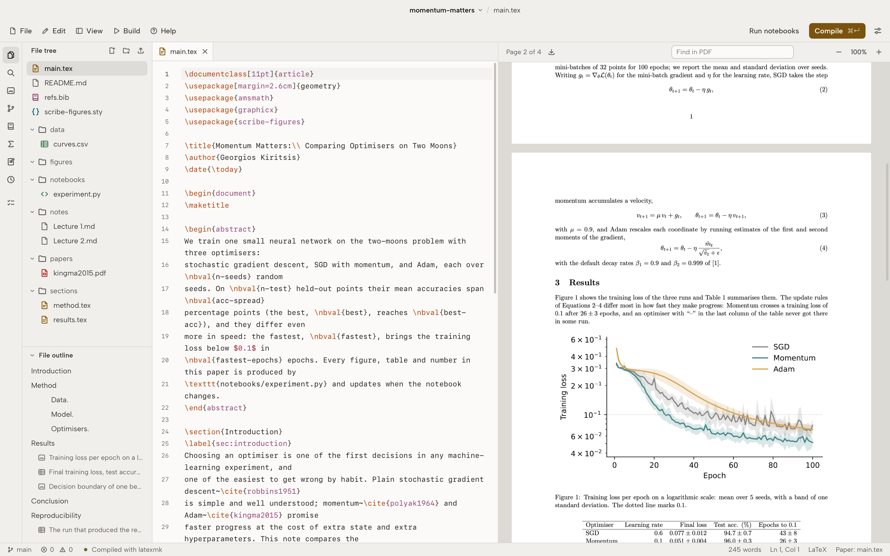

<p align="center">
  <picture>
    <source media="(prefers-color-scheme: dark)" srcset="docs/logo-dark.svg">
    
  </picture>
</p>

<p align="center">
  <a href="LICENSE"></a>
  
  
  
  
</p>

<p align="center">
  <a href="https://scribe.georgekiritsis.com"><b>Website</b></a>
  &nbsp;&middot;&nbsp;
  <a href="#what-it-does"><b>Features</b></a>
  &nbsp;&middot;&nbsp;
  <a href="#a-notebook-in-the-paper"><b>Notebooks</b></a>
  &nbsp;&middot;&nbsp;
  <a href="#building-from-source"><b>Build</b></a>
  &nbsp;&middot;&nbsp;
  <a href="#development"><b>Development</b></a>
  &nbsp;&middot;&nbsp;
  <a href="#license"><b>License</b></a>
</p>

<br>

Scribe is a desktop editor for LaTeX papers. A paper, the Python notebooks behind it and the
figures they make live in one project folder, and the figures and numbers in the PDF come
straight from the notebooks. Everything compiles on your machine with Tectonic or TeX Live.
There is no account and nothing is uploaded.

<picture>
  <source media="(prefers-color-scheme: dark)" srcset="docs/screenshot-dark.png">
  
</picture>

## What it does

**Writing.** A CodeMirror editor that knows LaTeX: completion for commands, labels, citations,
figures and notebook values; a preview of the formula under the cursor; a symbol palette; tables
edited as a grid. The paper compiles as you type if you want it to, and errors are explained in
plain words and underlined in the source. Click in the PDF to find the line, and the other way
round (SyncTeX). Spell check uses the system dictionary on macOS.

**Notebooks and figures.** Python files with `# %%` cells and Jupyter `.ipynb` notebooks run in
a Python kernel that Scribe keeps running. A figure cell saves `figures/<id>.pdf`, which the paper includes with
`\nbfig{id}`; `nbval` and `nbtable` send numbers and tables to the paper, typeset with siunitx.
When a notebook changes, its figures are marked out of date and rerun on the next compile. Each
run records the Python version, packages, seed and git commit.

**TikZ.** The picture under the cursor is compiled on its own and drawn beside the source in
about half a second. Points and nodes can be dragged, shapes drawn on a grid and restyled from a
style bar; every change is written back into the TikZ. Pictures export to PDF, SVG or PNG.

**References.** Add a BibTeX entry from a DOI or an arXiv ID, or pick it from a running Zotero.

**Before submitting.** One command lists missing citations and labels, figures the text never
refers to, stale notebooks, leftover TODOs, and what arXiv would object to. Export bundles the
sources into a zip ready to upload.

**Notes and reading.** Markdown notes with maths, links between notes and citations; PDFs in
`papers/` open in a reader whose highlights land in the paper's note; `Q:` and `A:` lines become
revision cards.

**Projects.** Templates for a plain article, IEEE and ACM conference papers, a thesis, slides and
lecture notes; import from an Overleaf zip or a git URL; a git panel; earlier versions of every file kept on save; a terminal.

## A notebook in the paper

A cell marked as a figure in `notebooks/experiment.py`:

```python
# %% [figure: fig-loss]
fig, ax = plt.subplots()
ax.semilogy(epochs, loss)
nbval("best-acc", 96.4, unit="%", err=0.3)
```

and the paper that uses it:

```latex
\usepackage{scribe-figures}
...
The best run reaches \nbval{best-acc} (Figure~\ref{fig:loss}).
\begin{figure}
  \centering
  \nbfig{fig-loss}
  \caption{Training loss.}\label{fig:loss}
\end{figure}
```

Compiling runs the notebook if it changed, writes `figures/fig-loss.pdf` and the values, and
typesets the paper. The example project in [`example/`](example) is a complete paper built this
way.

## Building from source

There are no release builds yet. Scribe is a [Tauri 2](https://tauri.app) app: a TypeScript
front end and a Rust back end. On every system you need:

- [Node.js](https://nodejs.org) 20 or later
- [Rust](https://rustup.rs) (stable)
- a TeX engine: [Tectonic](https://tectonic-typesetting.github.io), which the app can install for
  you on first run, or a TeX distribution with `latexmk`
- Python 3 with matplotlib, for notebooks (optional)

Then, in a clone of this repository:

```sh
npm install
npm run tauri dev      # run it, with hot reload
npm run tauri build    # an installable build, in src-tauri/target/release/bundle/
```

### macOS

```sh
xcode-select --install          # Apple's compilers
brew install node rustup tectonic
rustup default stable
```

`npm run tauri build -- --bundles app` makes `Scribe.app` alone, without a disk image. macOS is
where Scribe is used every day.

### Windows

1. Install the [Microsoft C++ Build Tools](https://visualstudio.microsoft.com/visual-cpp-build-tools/)
   with the "Desktop development with C++" workload.
2. WebView2 ships with Windows 10 and 11; on older systems install the
   [Evergreen runtime](https://developer.microsoft.com/microsoft-edge/webview2/).
3. Install Rust with `rustup` (the default MSVC toolchain) and Node.js.
4. For TeX, let Scribe install Tectonic, or install [MiKTeX](https://miktex.org) or TeX Live;
   `latexmk` on MiKTeX also needs Perl.

`npm run tauri build` produces an `.msi` and an `.exe` installer.

### Linux

Debian and Ubuntu:

```sh
sudo apt install libwebkit2gtk-4.1-dev build-essential curl wget file \
  libxdo-dev libssl-dev libayatana-appindicator3-dev librsvg2-dev
```

Fedora:

```sh
sudo dnf install webkit2gtk4.1-devel openssl-devel curl wget file \
  libappindicator-gtk3-devel librsvg2-devel
sudo dnf group install "c-development"
```

Arch:

```sh
sudo pacman -S webkit2gtk-4.1 base-devel curl wget file openssl \
  appmenu-gtk-module libappindicator-gtk3 librsvg xdotool
```

`npm run tauri build` produces `.deb`, `.rpm` and AppImage packages.

### If compiling or notebooks don't work

Apps opened from the desktop don't always see the `PATH` your shell has. Scribe reads it from
your login shell at start-up; to see what it finds, run the binary with `--check-tools`:

```sh
src-tauri/target/release/bundle/macos/Scribe.app/Contents/MacOS/scribe --check-tools
```

## Development

| Path | What is there |
|---|---|
| `src/` | The front end: TypeScript and the DOM, no framework. CodeMirror 6, pdf.js, xterm.js. |
| `src-tauri/src/lib.rs` | The back end: files, compiling, the Python kernel, git, search, settings. |
| `example/` | A short paper with its notebook, used by the tests and as a first project. |
| `demo/tikz/` | Pictures for trying the TikZ preview and canvas. |

Every command that touches files takes the project folder and a path inside it, and refuses any
path that leaves the folder, symlinks included. Saves are written to a temporary file and renamed,
so a crash can't leave half a file.

```sh
cd src-tauri && cargo test     # back end tests; compiles the example paper
npx tsc --noEmit               # type-check the front end
```

## License

[MIT](LICENSE)
